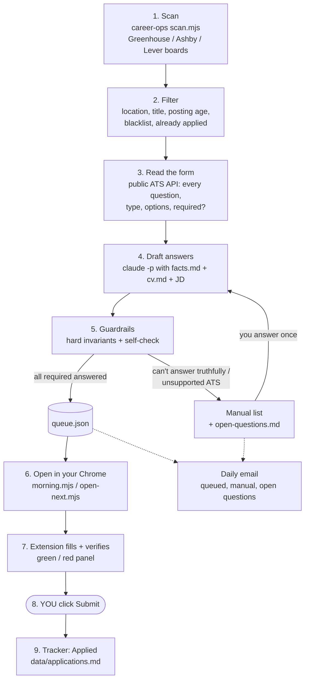

# career-ops autofill

A companion to [career-ops](https://github.com/career-ops-hq/career-ops) that does the boring part of job applications in **your own Chrome**:

1. **Every morning (no browser):** scan job boards → filter (location, title, blacklist, already applied) → read each form's questions from the public Greenhouse / Ashby APIs → draft answers with `claude -p` from `facts.md` + `cv.md` only → enforce hard invariants → queue.
2. **Chrome extension:** when you open a queued application, it fills every field, attaches your resume, verifies each answer actually stuck, and shows a green/red panel. **It never clicks Submit.** You review and submit.
3. **Daily email:** what was queued, what needs you (with resume attached), and questions the system couldn't answer.

No headless browsers, no automated submission, no CAPTCHA handling. Automated browsers get flagged by ATS anti-abuse systems; your own Chrome with you clicking Submit does not look like a bot because it isn't one.

## How it works



### What you can customize at each step

| Step | Knob | Where |
|---|---|---|
| 1. Scan | which companies / boards | career-ops `portals.yml` → `tracked_companies` (add with `discover-ats.mjs`) |
| 2. Filter | title keywords (include / exclude) | `portals.yml` → `title_filter.positive` / `negative` |
| | location | `portals.yml` → `location_filter`; `BAY` regex in `prepare.mjs` |
| | posting age | `portals.yml` → `max_posting_age_days` |
| | companies never to apply to | career-ops `data/blacklist.md` |
| 4. Draft | **the facts the LLM may use** | `facts.md` (+ career-ops `cv.md`) |
| | **how open questions are written** (length, tone, which story to pick, "no buzzwords") | `RULES` block in `draft()` in `prepare.mjs` |
| | model | `--model sonnet` in `draft()` |
| | answers to recurring unknown questions | `open-questions.md` (answer once, used forever) |
| 5. Guardrails | forced answers (sponsorship, work auth, EEO, …) | `INVARIANTS` in `prepare.mjs` |
| | forms that forbid AI-written answers | `AI_POLICY` regex in `prepare.mjs` |
| 6. Open | how many per batch / per day | `node open-next.mjs N`; `DAILY_MAX` in `.env` |
| | when the morning run fires | `launchd/morning.plist.tmpl` (default: login + 08:00) |
| 7. Fill | new widget types | `fillBox()` in `extension/content.js`; failures are dumped to `logs/dom/`; test with `node test/fill.test.mjs` |
| | city for location type-aheads | `HOME_CITY` in `.env` |
| Email | recipient / sender | `SUMMARY_TO`, `GMAIL_USER`, `GMAIL_APP_PASSWORD` in `.env` |

## Guardrails

- **Facts-only drafting.** The model may use only `facts.md` and `cv.md`. A required question it can't answer truthfully sends the posting to the manual list instead of being guessed.
- **Hard invariants** (`prepare.mjs` → `INVARIANTS`), applied after the model: sponsorship, work authorization, "unrestricted / permanent" authorization, and EEO answers are forced to the values implied by your facts, and every change is logged.
- **Self-check before queueing:** every required field is answered and every choice is a real option.
- **Self-check in the page:** after filling, each answer's container is checked (button pressed, radio checked, dropdown chosen, file attached). Anything that didn't stick or that the draft didn't cover is listed in red and outlined.
- **Learning loop for new questions:**
  - Unanswerable required questions are appended to `open-questions.md`.
  - Write the answer once and it becomes a fact for every future form. `node prepare.mjs --no-scan --retry-manual` re-tries the postings that were blocked.
  - Widgets the filler doesn't understand are dumped to `logs/dom/` so the filler can be taught them.

## Setup (macOS)

```sh
# inside your career-ops checkout (cv.md, portals.yml, data/ already set up)
git clone <this repo> local/auto-apply
cd local/auto-apply
cp ~/path/to/your/resume.pdf resume.pdf
./install.sh                      # npm install, facts.md from template, LaunchAgents
$EDITOR facts.md
```

Add the following to career-ops' `.env`:

```
GMAIL_USER=you@gmail.com
GMAIL_APP_PASSWORD=xxxx xxxx xxxx xxxx   # Google account → Security → App passwords
SUMMARY_TO=where-the-daily-email-goes@example.com
HOME_CITY=Your City, State              # used for location type-aheads
DAILY_MAX=20                            # max applications opened per day
```

Load the extension: `chrome://extensions` → Developer mode → Load unpacked → `extension/`.

## Daily use

| Command | What it does |
|---|---|
| (automatic at login / 08:00) `node morning.mjs` | scan + draft + email + open the first 10 in Chrome |
| `node open-next.mjs 10` | open the next 10 (daily cap `DAILY_MAX`, default 20; round-robin across companies) |
| `node prepare.mjs --no-scan --retry-manual` | re-try manual postings after you answered open questions |

When you submit, the extension sees the confirmation page and marks the row `Applied` in `data/applications.md`.

## Files

| File | Role |
|---|---|
| `prepare.mjs` | filter, read forms via API, draft, invariants, self-check, queue |
| `server.mjs` | `127.0.0.1:47821` bridge: queue item, resume, applied, DOM debug dumps |
| `extension/` | MV3 content script: fill, verify, panel; never submits |
| `morning.mjs`, `open-next.mjs`, `email.mjs` | daily orchestration and summary |
| `facts.md`, `resume.pdf`, `open-questions.md`, `queue.json`, `state.json`, `logs/` | **personal, gitignored** |

Supported ATSs: Greenhouse and Ashby. Anything else goes to the manual list.
